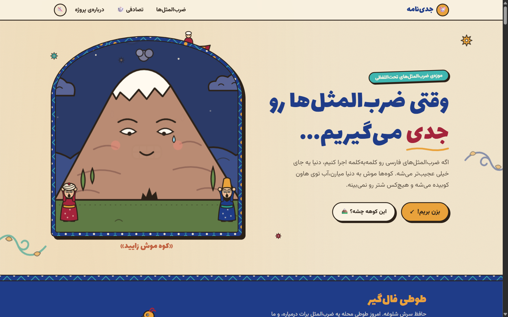
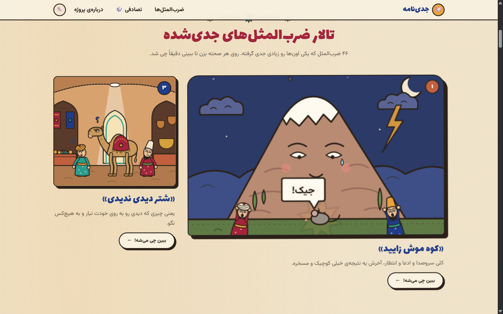
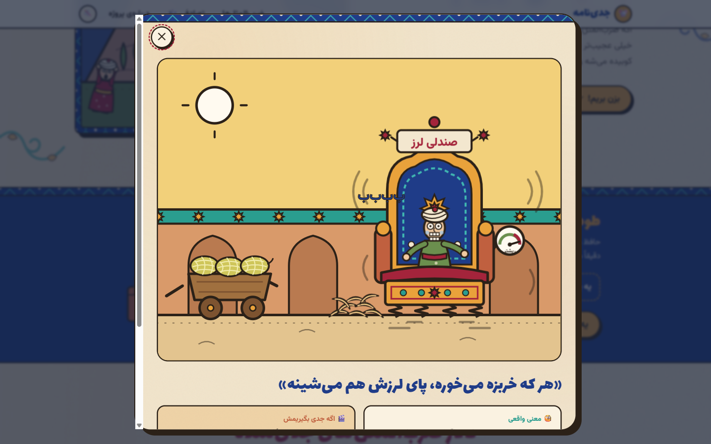
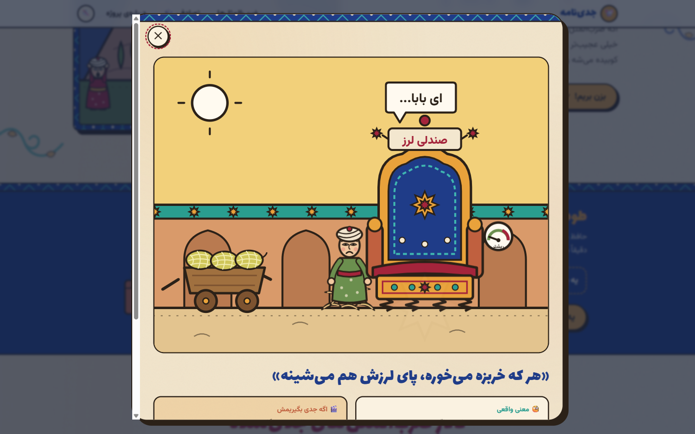
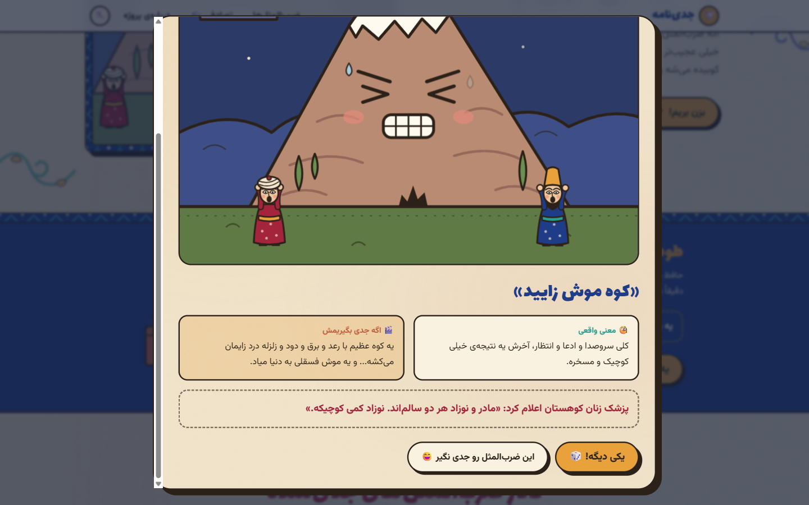
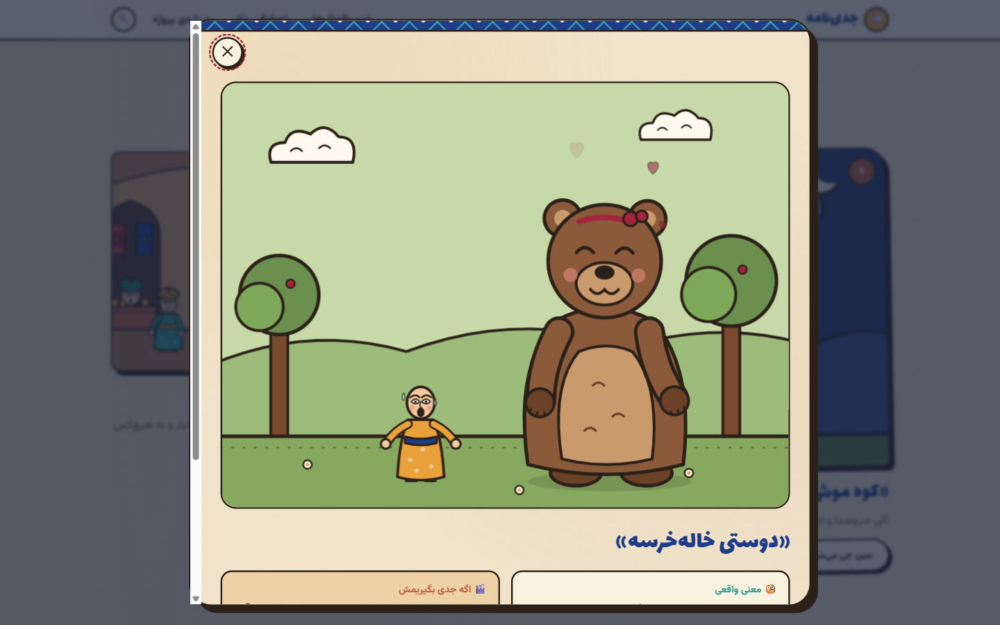
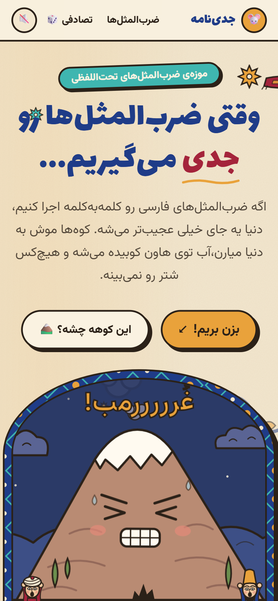
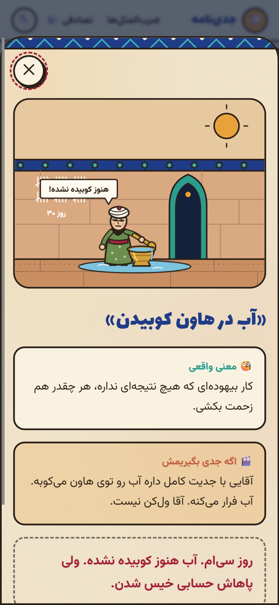
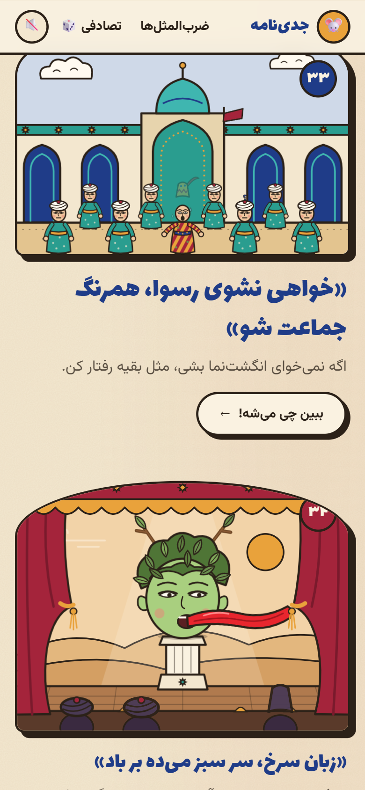

# جدی‌نامه — Persian proverbs, taken seriously

> «وقتی ضرب‌المثل‌ها رو جدی می‌گیریم...»

**Jedi-nameh** is a playful, interactive website that takes Persian proverbs **literally** and turns each one into a small animated scene.

What if a mountain really gave birth to a mouse (کوه موش زایید)? What if someone really pounded water in a mortar (آب در هاون کوبیدن)? What if a whole street pretended not to see a camel (شتر دیدی ندیدی)? This site shows you, with completely serious characters and epic staging.

The look mixes Persian miniature painting, tile patterns and old illustrated books with a modern, flat cartoon style. The whole site is in Persian and reads right to left.



---

## What's inside

- **46 proverbs, each with its own animated scene.** Every scene is a hand-built SVG illustration with CSS animation. There are no image files or videos.
- **Gallery.** Large, wide and normal cards in different frame shapes. The first 17 proverbs are shown, with a button to reveal the rest. Scenes only run while they're near the screen.
- **Scene view.** Clicking a proverb opens a big version of its scene, together with:
  - the real meaning
  - the literal version («اگه جدی بگیریمش»)
  - a short deadpan joke
  - «یکی دیگه!» to jump to another random proverb
  - «این ضرب‌المثل رو جدی نگیر 😄», which spins the scene and swaps in silly lines
- **Fortune-teller parrot (طوطی فال‌گیر).** A random-proverb mode styled like a street fortune-teller's parrot picking an envelope.
- **Sound effects.** Small comic sounds (splash, squeak, clang…) generated in the browser. **Sound is off by default** and is toggled in the header.
- **Easter eggs.** Hover the flying carpet, click the mouse that comes out of the mountain, and pet the cat walking along the footer.
- **Accessibility.**
  - right-to-left layout throughout, with Persian numerals
  - keyboard-friendly scene view: Esc closes it, Tab stays inside it, and focus returns to where it was
  - a "skip to proverbs" link
  - support for the reduced-motion setting: each scene shows a still frame instead of animating
- **Responsive.** Works from wide desktops down to 320px-wide phones without sideways scrolling.

---

## Screenshots

| | |
|---|---|
|  |  |
| **Gallery** | **Fortune-teller parrot picking a random proverb** |
|  |  |
| **Scene view: «هر که خربزه می‌خوره، پای لرزش هم می‌شینه»** | **«کوه موش زایید» with its meaning and joke** |
|  | |
| **«دوستی خاله‌خرسه»** | |

### On mobile

| | | |
|---|---|---|
|  |  |  |
| Home | Scene view | Gallery |

---

## How it works

**Stack:** React 18, TypeScript, Vite, Tailwind CSS 4 and Framer Motion. There is no backend; all proverb data lives in a local file.

```
src/
  data/proverbs.ts       all proverb texts (meaning, literal version, joke, card size, colour, sound)
  scenes/
    parts.tsx            shared drawing kit: Scene, Person, Face, Turban, Mouse, Cloud, Bubble…
    index.ts             maps each proverb id to its scene file (scenes load on demand)
    KohMoosh.tsx …       one file per proverb scene (46 files)
  components/            Header, Hero, FortuneParrot, Gallery, SceneModal, About, Donate, Footer
  lib/sound.ts           tiny sound effects made with the Web Audio API
  index.css              colours, paper texture, tile patterns, shared animations
server.mjs               small dependency-free server used in the Docker image
```

- **Scenes.** Each scene is an SVG drawn on a 400×300 canvas, built from the shared kit in `parts.tsx`. That keeps every character in the same style: ink outlines, almond eyes, turbans and patterned robes. Animations are plain CSS keyframes.
- **Speech bubbles.** The shared `Bubble` wraps long Persian text onto several lines. It moves inward from the edges, or below the speaker when there's no room above, so dialogue is never cut off.
- **Performance.** Each scene's code loads only when its card first scrolls near the screen. Scenes that are off screen pause their animations.

---

## Running it

You need **Node.js 20.19 or newer**.

```bash
npm install
npm run dev        # development server with live reload
npm run build      # type-check and build the site into dist/
npm run preview    # preview the built site
```

### With Docker

```bash
docker compose up -d --build
```

The site is served at **http://localhost:8090** by default. To use a different port or Node image:

```bash
PORT=8080 docker compose up -d --build
NODE_IMAGE=node:22-alpine docker compose build
```

The built site is plain static files (`dist/`), so it can also be hosted on any static host, such as Cloudflare Pages, Netlify or GitHub Pages.

---

## Adding a new proverb

1. Add an entry to `src/data/proverbs.ts` with an `id`, the proverb, its meaning, the literal version, a joke, a card `size`, a background colour and a sound.
2. Create `src/scenes/<Name>.tsx`. Draw it inside `<Scene>` with the shared parts from `parts.tsx`.
3. Add one `"<id>": "<Name>"` line to `src/scenes/index.ts`.
